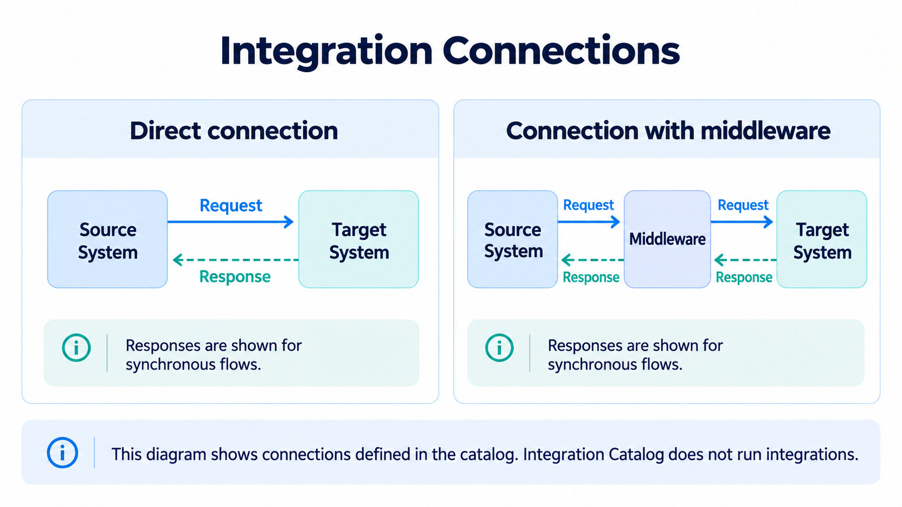
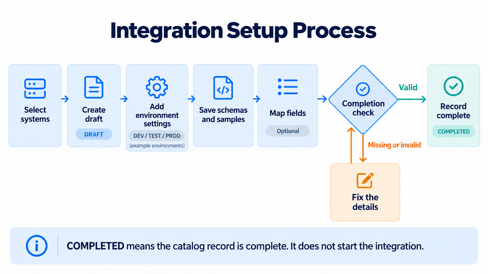
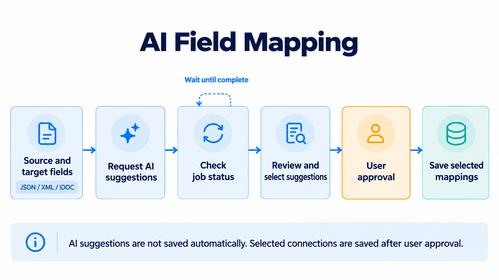

# Integration Catalog Backend

Integration Catalog is an integration-focused **Enterprise Architecture Portal**.
It helps large companies document complex systems and their connections. It records
which system sends data to another system, the data formats, and the field mappings.
AI supports this work by suggesting field mappings.

**This project is not a data transfer engine.** It does not move data between
systems or run integrations.

This repository contains the portal's REST API backend. The frontend is a separate
project. The API manages integrations, environment settings, encrypted credentials,
user invitations, and roles.

**Technologies:** Java 21 · Spring Boot 3.5.16 · Spring Security · Spring Data JPA · PostgreSQL

## Main workflows

### System connections

Select a source, a target, and optional middleware from the shared system catalog.



### Integration setup

Select systems → create a `DRAFT` → add environment settings → save schemas and
samples → optionally map fields → check completion → `COMPLETED`.



API examples and completion rules: [Integration workflow](docs/integration-workflow.md).

### AI field mapping

Map JSON/XML/IDOC fields manually or with AI suggestions. CSV/Excel files are stored
as samples only. AI is off by default. The default provider is local Ollama.
The optional Gemini provider sends field metadata and optional sample values to Google.



Setup and API: [AI mapping assistant](docs/ai-mapping.md). Suggestions are saved only after user approval.

## Getting started

Docker and Docker Compose are required. For local development and tests, use JDK 21
and the Maven Wrapper included in this repository.

### 1. Prepare the environment file

```sh
cp .env.example .env
```

Set these values in `.env`:

| Variable | Value |
|---|---|
| `POSTGRES_PASSWORD` | Database password |
| `CATALOG_ADMIN_USERNAME` | First admin username; the example uses `admin` |
| `CATALOG_ADMIN_PASSWORD` | First admin password; 12–128 characters |
| `CATALOG_CREDENTIALS_KEY` | Generate once with `openssl rand -base64 32` |

Keep the encryption key safe. For an existing database, keep its current password
and key. IDEs and Maven do not load `.env` automatically.

### 2. Start the services

```sh
docker compose --profile mail up --build -d --wait --wait-timeout 180
docker compose ps
curl -i http://localhost:8080/actuator/health/readiness
```

The `mail` profile starts the Mailpit test inbox. It does not send email to real recipients.

### 3. Connect to the API

These addresses use the default ports:

| Address | Purpose |
|---|---|
| `http://localhost:8080/api/v1` | API root; session and role checks apply |
| `http://localhost:8080/swagger-ui/index.html` | Swagger; requires an ADMIN session |
| `http://localhost:8080/v3/api-docs` | OpenAPI JSON; requires an ADMIN session |
| `http://localhost:8080/actuator/health/readiness` | Health check; no login required |
| `http://localhost:8025` | Mailpit test inbox |

Login: **get CSRF → submit form login → refresh CSRF**. Keep the session cookie.
[Runnable client example](docs/frontend-integration.md#sessions-and-csrf).

## Documentation

All guides are listed in the [documentation index](docs/README.md).

| Need | Guide |
|---|---|
| Sessions and screen workflows | [Frontend integration](docs/frontend-integration.md) |
| Endpoints and validation | [API reference](docs/api-reference.md) |
| Error codes, field errors, and localization | [Error contract and catalog](docs/error-codes.md) |
| Environment variables, IDE setup, troubleshooting | [Configuration](docs/configuration.md) |
| Formats and file rules | [Payloads](docs/payload-content.md) |
| Data model and production limits | [Architecture](docs/architecture.md) |

## Tests

Run tests without the application startup test, which needs a database:

```sh
./mvnw -B '-Dtest=*Tests,!IntegrationCatalogApplicationTests' test
```

`./mvnw test` also needs PostgreSQL, the encryption key, and first admin settings
when the user table is empty. Enable [optional database tests](docs/payload-content.md#database-upgrades-and-tests)
separately. The Docker image build does not run tests.

## Repository checks and CI

```sh
python3 scripts/check_repository.py
python3 scripts/generate_error_catalog.py --check
```

These checks inspect tracked file names, local Markdown links, and error catalog
updates. [CI](.github/workflows/ci.yml) runs all tests with Java 21/PostgreSQL 16
and builds a JAR. [Dependabot](.github/dependabot.yml) checks dependencies weekly.

## Development status

The project is at the MVP/pilot stage. [Production acceptance](docs/architecture.md#release-and-production-limits)
is not complete.

## License

This project is licensed under the [MIT License](LICENSE).
