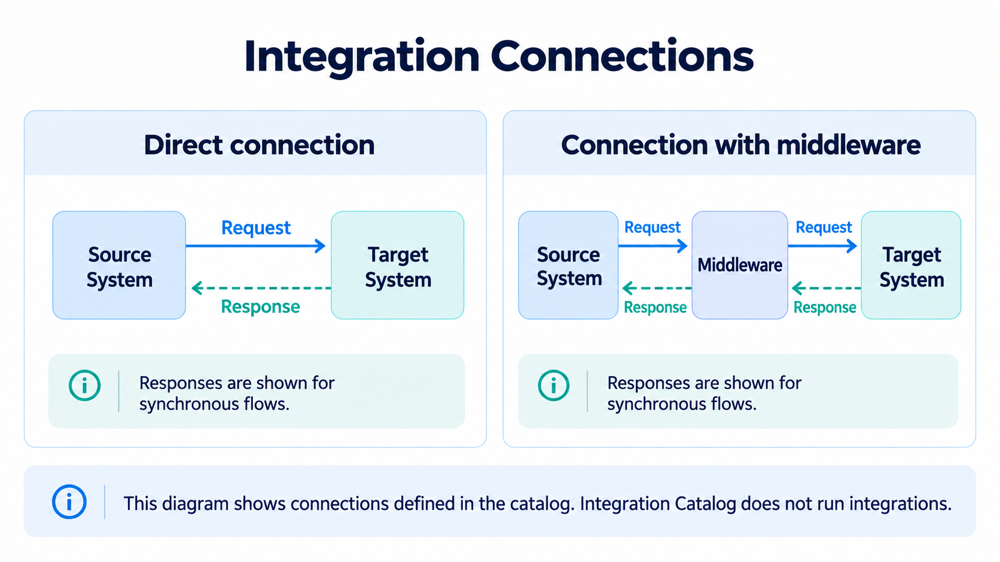
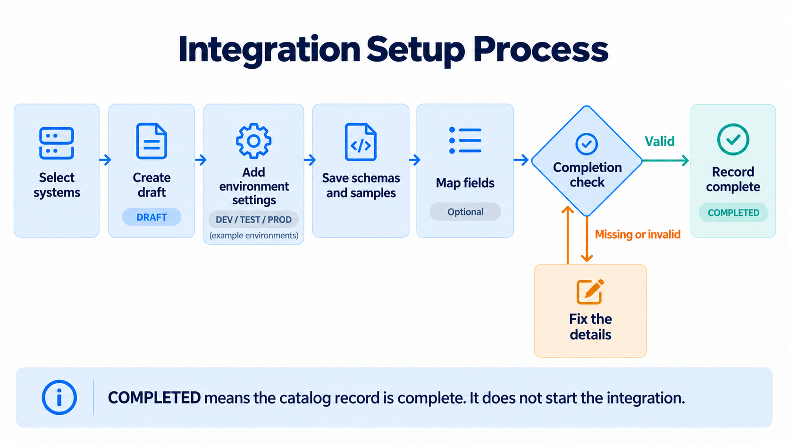
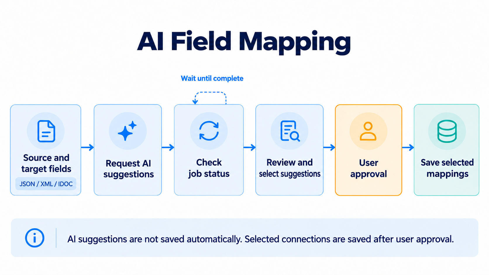

# Integration Catalog Backend

Integration Catalog is an integration-focused **Enterprise Architecture Portal**.
It helps large companies document complex systems and their connections. It records
which system sends data to another system, the data formats, and the field mappings.
AI supports this work by suggesting field mappings.

**This project is not a data transfer engine.** It does not move data between
systems or run integrations.

This repository contains the portal's REST API backend. The frontend is a separate
project. The API manages integrations, environment settings, encrypted credentials,
user invitations, and roles.

**Technologies:** Java 21 · Spring Boot 3.5.16 · Spring Security · Spring Session JDBC · Spring Data JPA · PostgreSQL · Flyway

## Main workflows

### System connections

Select a source, a target, and optional middleware from the shared system catalog.



### Integration setup

Select systems → create a `DRAFT` → add environment settings → save schemas and
samples → optionally map fields → check completion → `COMPLETED`.



API examples and completion rules: [Integration workflow](docs/integration-workflow.md).

### AI field mapping

Map JSON/XML/IDOC fields manually or with AI suggestions. CSV/Excel files are stored
as samples only. AI is off by default. The default provider is local Ollama.
The optional Gemini provider sends field metadata and optional sample values to Google.



Setup and API: [AI mapping assistant](docs/ai-mapping.md). Suggestions are saved only after user approval.

## Getting started

For the Docker setup below, install Git and Docker with the Compose v2 plugin
(`docker compose`). Make sure Docker is running. Java, Maven, and PostgreSQL run
inside containers; you do not need to install them on your computer.

The commands use a Unix-style shell, such as the macOS/Linux terminal or Git Bash/WSL
on Windows. You also need OpenSSL to generate the encryption key and curl for the
health check. The login example below uses Postman.

To run the backend from an IDE or run tests locally, install **JDK 21** and use the
included Maven Wrapper; a separate Maven installation is not required. See
[running from an IDE](docs/configuration.md#running-from-an-ide).

### 1. Clone the repository

```sh
git clone https://github.com/EnginKisin/integration-catalog.git
cd integration-catalog
```

Run all commands below from this repository directory.

### 2. Prepare the environment file

For a fresh setup, create `.env` from the template. If `.env` already exists, edit
it instead of overwriting it.

```sh
cp .env.example .env
```

Open `.env` in a text editor and fill in these values:

| Variable | Value |
|---|---|
| `POSTGRES_PASSWORD` | Database password |
| `CATALOG_ADMIN_USERNAME` | First admin username; the example uses `admin` |
| `CATALOG_ADMIN_PASSWORD` | First admin password; 12–128 characters |
| `CATALOG_CREDENTIALS_KEY` | Paste the output of the command below |

Generate the encryption key once:

```sh
openssl rand -base64 32
```

Copy the generated value after `CATALOG_CREDENTIALS_KEY=` in `.env` and save the file.
Keep the remaining defaults for this local setup; AI is disabled and no AI model or
API key is needed. Compose reads `.env` automatically; IDEs and Maven do not.

Keep the encryption key safe and reuse it on later starts. If you already have a
`.env` or database, keep the existing database password and key instead of
overwriting them. Use an empty database for a fresh installation; for an older
Hibernate-managed database, read the [migration guide](docs/database-migrations.md)
before starting.

### 3. Start the services

```sh
docker compose --profile mail up --build -d --wait --wait-timeout 180
docker compose ps
```

This builds the backend and starts PostgreSQL and the Mailpit test inbox. The first
build downloads images and Maven dependencies, so it can take several minutes.
The database schema and first admin account are created automatically.
Mailpit captures local emails; it does not send them to real recipients.

### 4. Verify that the backend is ready

```sh
curl -i http://localhost:8080/actuator/health/readiness
```

Expect **HTTP 200** and this response body:

```json
{"status":"UP"}
```

No login is needed for this check. If it fails, use the
[quick troubleshooting steps](#quick-troubleshooting) below.

### 5. Log in and make your first API request

You can test the backend with Postman without a frontend. Keep Postman's cookie
jar enabled and use `localhost` for every request so the session cookie is reused.

1. Send `GET http://localhost:8080/api/v1/auth/csrf`. From the JSON response, copy
   `headerName` and `token`.
2. Send `POST http://localhost:8080/api/v1/auth/login`. In **Headers**, add a header
   whose name is the returned `headerName` and whose value is the returned `token`.
   In **Body → x-www-form-urlencoded**, add `username` and `password` using the
   `CATALOG_ADMIN_USERNAME` and `CATALOG_ADMIN_PASSWORD` values you saved in `.env`.
   Expect **HTTP 200 with an empty body**. Postman keeps the updated session cookie.
3. Send `GET http://localhost:8080/api/v1/auth/csrf` again. Login changes the session;
   use this new token in the returned header on later POST/PUT/PATCH/DELETE requests.
4. Send `GET http://localhost:8080/api/v1/auth/me`. Expect **HTTP 200** with your
   username and `ROLE_ADMIN` in `authorities`. This confirms authenticated API access.

The admin credentials are used to create the first account only. Editing them in
`.env` later does not change an existing account's password.
For a frontend client example, see [sessions and CSRF](docs/frontend-integration.md#sessions-and-csrf).

### Local service addresses

These addresses use the default ports:

| Address | Purpose |
|---|---|
| `http://localhost:8080/api/v1` | Base URL; append an endpoint such as `/auth/me` |
| `http://localhost:8080/swagger-ui/index.html` | Swagger; requires an ADMIN session |
| `http://localhost:8080/v3/api-docs` | OpenAPI JSON; requires an ADMIN session |
| `http://localhost:8080/actuator/health/readiness` | Health check; no login required |
| `http://localhost:8025` | Mailpit test inbox |

Postman's login session is separate from your browser's session. To open Swagger
in a browser, log in through the frontend in that browser using the same hostname;
see [first session and Swagger](docs/frontend-integration.md#first-session-and-swagger).

### Quick troubleshooting

| Problem | What to do |
|---|---|
| Docker connection error | Start Docker and check `docker compose version`. |
| Port already in use | Change `APP_PORT` or `POSTGRES_PORT` in `.env`, then rerun the start command. If `APP_PORT` changes, use that port in the API URLs above. |
| Startup fails or the app is unhealthy | Run `docker compose ps` and `docker compose logs --tail=100 app`. Check the database password, encryption key, and first admin settings. |
| Login returns 403 | Get a CSRF token again and send it in the returned header; keep cookies enabled and use the same hostname. |
| Login returns 401 | Check the stored account's username and password. Changing bootstrap values in `.env` does not reset an existing password. |

To stop the services while keeping your database:

```sh
docker compose down
```

Do not add `-v` for a normal shutdown; it deletes the Compose volumes, including
database data. More help: [configuration and troubleshooting](docs/configuration.md#troubleshooting).

### Database and session details

Flyway creates the schema on an empty database and applies new migrations on
later starts; Hibernate validates entity compatibility. Existing databases from
the former Hibernate `update` setup must be reset for this transition.
See [database migrations and the local reset commands](docs/database-migrations.md).

Sessions are stored in PostgreSQL through Spring Session JDBC. No extra service
is required. Compatible backend instances using the same database/schema share
sessions; unexpired sessions also survive a backend restart. The existing
`JSESSIONID` cookie and login/CSRF API remain unchanged. See [session storage](docs/authentication.md#shared-jdbc-sessions).

## Documentation

All guides are listed in the [documentation index](docs/README.md).

| Need | Guide |
|---|---|
| Sessions and screen workflows | [Frontend integration](docs/frontend-integration.md) |
| Endpoints and validation | [API reference](docs/api-reference.md) |
| Error codes, field errors, and localization | [Error contract and catalog](docs/error-codes.md) |
| Environment variables, IDE setup, troubleshooting | [Configuration](docs/configuration.md) |
| Schema migrations, fresh setup, and database reset | [Database migrations](docs/database-migrations.md) |
| Formats and file rules | [Payloads](docs/payload-content.md) |
| Data model and production limits | [Architecture](docs/architecture.md) |

## Tests

Run tests without the application startup test, which needs a database:

```sh
./mvnw -B '-Dtest=*Tests,!IntegrationCatalogApplicationTests' test
```

`./mvnw test` also needs PostgreSQL, the encryption key, and first admin settings
when the user table is empty. Enable [optional database tests](docs/payload-content.md#database-upgrades-and-tests)
separately. The Docker image build does not run tests.

## Repository checks and CI

```sh
python3 scripts/check_repository.py
python3 scripts/generate_error_catalog.py --check
```

These checks inspect tracked file names, local Markdown links, and error catalog
updates. [CI](.github/workflows/ci.yml) runs all tests with Java 21/PostgreSQL 16
and builds a JAR. [Dependabot](.github/dependabot.yml) checks dependencies weekly.

## Development status

The project is at the MVP/pilot stage. [Production acceptance](docs/architecture.md#release-and-production-limits)
is not complete.

## License

This project is licensed under the [MIT License](LICENSE).
