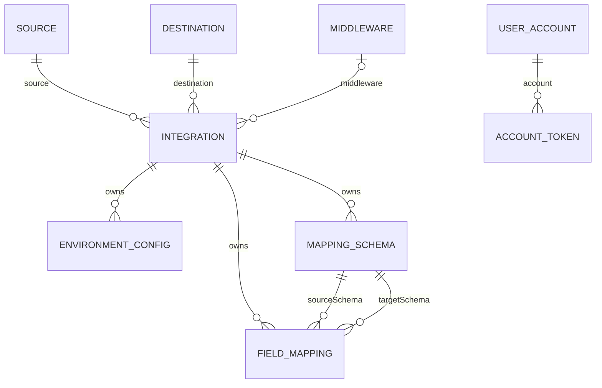
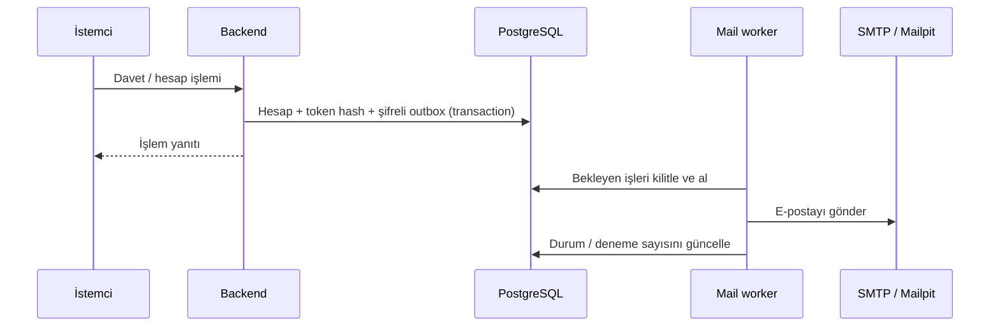

# Mimari, kapsam ve doğrulama

Backend tek bir Spring Boot uygulamasıdır. Controller katmanı HTTP/DTO,
service katmanı iş kuralları ve transaction, repository katmanı JPA/PostgreSQL
erişimini üstlenir. Güvenlik filtreleri oturum, CSRF, rol ve güncel hesap kontrolünü yapar.

## Veri ilişkileri

Source ve destination zorunlu, middleware seçime bağlıdır. Ortam ayarları,
şemalar ve alan eşlemeleri entegrasyon aggregate'ına aittir. Ortak katalog kaydını
silmek entegrasyonu veya FK'lerini boşaltmaz; kullanım varsa silme engellenir.
`usageCount` taslak ve tamamlanmış kayıtların tamamını içerir.

Hesaplar `user_accounts`, ek izinler `user_permissions`, tek kullanımlık
token'lar `account_tokens`, hesap audit'i `account_audit`, şifreli posta işleri
`mail_outbox` tablolarında saklanır. Entity adlarından üretilen fiziksel şema
ayrıntıları için model sınıfları esas alınmalıdır.

## Tutarlılık ve güvenlik

Entegrasyon teknik/alt veri değişiklikleri ve tamamlama transaction içinde
çalışır. Güncellenen entegrasyon ve seçilen katalog satırları ilgili işlemlerde
kilitlenir. Katalog aktiflik/silme kontrolleri ile yeni bağlantı atama aynı satırı
kilitleyerek sıralanır. Son aktif ADMIN koruması ve token tüketimi de transaction
ve satır kilitleri kullanır. Gerçek PostgreSQL davranışı ayrıca doğrulanmalıdır.

Entegrasyonda entity sürümlemesi bulunur; API yanıtta sürüm/ETag vermez ve
istemciden beklenen sürüm almaz. Tarayıcıda uzun süre açık kalan formun başka
kullanıcının düzenlemesini ezmesini bütünüyle önleyen bir protokol henüz yoktur.

Parolalar PBKDF2 ile hash'lenir; dış sistem bilgileri geri çözülebilir AES-GCM
şifrelemesiyle korunur. Token doğrulama tablosunda SHA-256 hash vardır; e-posta
gönderilebilmesi için ham bağlantının şifreli kopyası geçici olarak outbox'ta tutulur.
Roller ve credential izinleri ayrıdır. Oturum sürümü her korunan istekte güncel
hesapla karşılaştırılır. Ayrıntılar: [güvenlik](authentication.md), [kullanıcı yaşam döngüsü](user-management.md).

## Posta akışı

202/201 yanıtı SMTP teslimini beklemez. Worker'ın SMTP kabulünden sonra commit
öncesi kesilmesi çift gönderime yol açabilir; token tek kullanımlıdır. Uzun kuyruk
beklemesinde token postaya ulaşmadan sona erebilir. `mail-status` pending/failed
sayılarını verir; gelen kutusuna teslim edildiğini ölçmez. SMTP arızası katalog
readiness'ını düşürmez.

## Mevcut sınırlar

- Entegrasyon çalıştırma, dış sistem bağlantı testi ve AI mapping yoktur.
- JSON Schema standardı, JSON alan yolu varlığı ve tip dönüşümü doğrulanmaz.
  XML/IDOC alan yolları kontrol edilir; CSV/Excel yalnızca örnek dosya olarak saklanır.
- Tekil şema silme yoktur; topoloji değişiminde korunmuş uyumsuz şemalar tamamlamayı engelleyebilir.
- Credential map'lerinin auth türüne göre zorunlu anahtar sözleşmesi yoktur.
- Secret görüntülemede yeniden parola/MFA ve kalıcı DB audit endpoint'i yoktur.
- Session ve auth hız limiti instance belleğindedir; dağıtık session/limit kurulmadı.
- Katalog/entegrasyon listelerinde sayfalama yoktur; büyük veri performansı ayrıca ölçülmelidir.
- `ddl-auto=update` kullanılır; Flyway/Liquibase ile sürümlü migration henüz yoktur.
- Bütün framework hataları tek bir ayrıntılı alan hatası biçimine dönüştürülmez.
- Frontend hesap sayfaları, gerçek SMTP sağlayıcısı ve üretim HTTPS/reverse proxy kurulumu bu repoda tamamlanmış değildir.

## Test kapsamı ve doğrulama yöntemi

| Grup | Doğruladığı davranış |
|---|---|
| IntegrationServiceImpl / MappingServiceImpl testleri | Güncelleme, şema sahipliği, liste kaydetme |
| PayloadSchemas / PayloadWeb testleri | XML/IDOC alan ağacı, CSV/Excel dosyaları, boyut/format/yetki ve eşleme engelleri |
| PayloadPostgresTests (opt-in) | Gerçek PostgreSQL JSONB/TEXT/BYTEA kayıt/okuma ve upsert; [çalıştırma](payload-content.md#veritabanı-geçişi-ve-test) |
| IntegrationCompletion / IntegrationSystemSelection | Şema matrisi, inceleme, taslağa dönüş, pasif seçim |
| Source / Destination / MiddlewareManagement | Güncelleme, kullanım sayısı, aktiflik, silme |
| Security / CredentialSecurity / CatalogManagementWeb | Gerçek Spring Security filtreleri, roller, CSRF, secret yetkileri |
| CredentialCrypto / CredentialMigration | Şifreleme, yanlış anahtar, bozulma, mock JDBC ile dönüşüm |
| AccountLifecycle / AccountLifecycleWeb / AccountMail | Davet, reset, doğrulama, oturum iptali, outbox |
| AdminBootstrap / AuthRateLimitFilter | İlk kullanıcı ve hız sınırı |
| RequestValidation / HealthEndpoint | DTO doğrulamaları; Actuator gizliliği ve simüle edilmiş sağlık durumları |

`PayloadPostgresTests`, gerçek PostgreSQL üzerinde beş formatın JSONB/TEXT/BYTEA
kayıt/okuma ve upsert davranışını doğrular; test transaction'ları rollback olur.
Payload SQL migration'ı ayrıca eski şemayı temsil eden izole bir şemada denenmiş,
JSON içeriğinin korunması ve EXCEL CHECK kısıtları kontrol edilmiştir. Bu kontrol,
üretim verisiyle tam yükseltme veya bütün geçmiş sürümlerden geçiş testi değildir.

Hesap/katalog kilitlerinin eşzamanlılık davranışı, cascade silme, credential
migration'ı ve gerçek SMTP teslimi için bu testler yeterli değildir.
`IntegrationCatalogApplicationTests` tam uygulama context'ini açar ve çalışan
DB/config gerektirir. Normal test komutu [başlangıç belgesinde](../README.md),
opt-in DB testi [payload belgesindedir](payload-content.md#veritabanı-geçişi-ve-test).

Canlıya çıkış değerlendirmesinde gerçek DB ile eski veriyi yükseltme ve yedekten
dönüş, eşzamanlı silme/atama, entegrasyon cascade silme, gerçek SMTP akışları ve
Docker readiness geçişleri ayrıca sınanmalıdır. Mevcut belgeler bu kontrollerin
tamamlandığı veya backend'in üretim kabulünün yapıldığı iddiasını taşımaz.

## Erişim ve dosya işleme sınırları

Katalog erişimi rol bazında bütün uygulama için tanımlıdır; entegrasyon başına
sahiplik, ekip/tenant izolasyonu veya ayrı paylaşım yetkisi yoktur. VIEWER/EDITOR
rolleri kendilerine tanınan işlemleri bütün katalog kayıtlarında yapabilir.
Bu model, ekipler arasında gizli entegrasyon saklamak için tek başına yeterli değildir.

CSV/Excel örnekleri ve XML/IDOC ham içerikleri credential şifrelemesine dahil
değildir. Dosya ayrıştırma HTTP isteğinin JVM sürecinde, tamamlamada da yeniden
çalışır; ayrıca bir CPU/deadline veya ayrı parser süreci bulunmaz. Sıkıştırılmış
Excel'in yükleme boyutu, açıldığındaki bellek tüketimine üst sınır sağlamaz.
Dosya işleme yükü, örneklerde veri maskeleme ve saklama süresi üretim öncesi ele
alınmalıdır. Kütüphanenin [dosya işleme güvenliği rehberi](https://poi.apache.org/security.html)
bu sınırları ayrıca açıklar.
