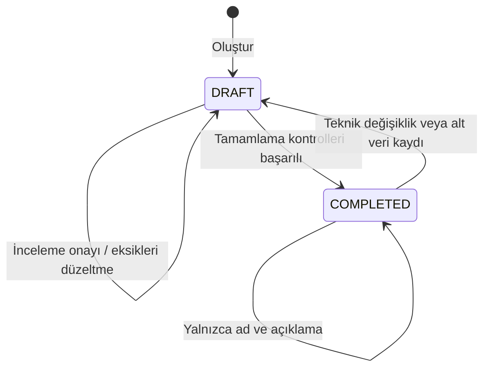

# Entegrasyon oluşturma ve düzenleme akışı

Entegrasyon önce `DRAFT` oluşturulur. Ortam ayarları, şemalar ve isteğe bağlı
alan eşlemeleri kaydedilir. Kullanıcı tamamlamayı istediğinde backend bütün
tamamlama kurallarını yeniden kontrol eder; başarılıysa `COMPLETED` olur.
Bu durum bir katalog kaydının tamamlandığını gösterir; entegrasyonu çalıştırmaz.

Bütün aşağıdaki yazma işlemleri EDITOR/ADMIN oturumu ve CSRF başlığı gerektirir.
Credential yazma için ayrıca [secret izinlerini](authentication.md) uygulayın.

## En küçük örnek: doğrudan, asenkron

1. `GET /api/v1/systems?active=true` ile ortak katalogdan kaynak ve hedefi seçin.
   Ara katmanlı akışta üçüncü seçim de aynı listeden yapılır. Gerekirse
   `POST /api/v1/systems` ile sistem oluşturun:

```json
{"name":"ERP","description":"Sipariş sistemi"}
```

2. `POST /api/v1/integrations` ile aşağıdaki gövdeyi gönderin. Burada source ID 1,
   destination ID 2 varsayılmıştır. Yanıttaki entegrasyon ID'sini sonraki adımlarda kullanın.

```json
{
  "name":"Sipariş aktarımı",
  "description":"ERP siparişlerinin hedef sisteme aktarım tanımı",
  "sourceSystemId":1,
  "destinationSystemId":2,
  "middlewareSystemId":null,
  "sourcePayloadFormat":"JSON",
  "destinationPayloadFormat":"JSON",
  "isSync":false,
  "hasMiddleware":false
}
```

3. Oluşan entegrasyon ID'si 10 ise `POST /api/v1/integrations/10/configs`:

```json
[
  {
    "configTarget":"DESTINATION",
    "environmentType":"DEV",
    "url":"https://destination.example.com/orders",
    "timeoutMs":5000,
    "authType":"NONE",
    "retryCount":0,
    "retryIntervalMs":0
  }
]
```

Bu URL'ye istek atılmaz; timeout/retry değerleri katalog metaverisidir.
Bu endpoint bütün config listesini kaydeder. Sonraki kayıtta yalnızca TEST
gönderirseniz DEV silinir. Aynı ortam/hedef çiftini iki kez göndermeyin.

4. `POST /api/v1/integrations/10/mappings/schemas`:

```json
{
  "schemaType":"SOURCE_TO_DEST_REQUEST",
  "format":"JSON",
  "schemaDefinition":{
    "type":"object",
    "properties":{
      "orderId":{"type":"string"}
    }
  },
  "samplePayload":{"orderId":"ORD-001"},
  "targetFormat":"JSON",
  "targetSamplePayload":{"externalOrderId":"ORD-001"}
}
```

Bu örnek JSON formatı içindir. `schemaDefinition` bir JSON nesnesidir;
JSON Schema standardının tamamı doğrulanmaz. Alternatif olarak `samplePayload`
verilebilir; bu durumda tanım örnekten alınır. Alan yolu kontrolleri ve bağımsız
hedef sözleşmesi [payload rehberindedir](payload-content.md#eşleme-ve-tamamlama).

XML/IDOC için `format` + `rawContent` gönderilir; alan ağacını backend üretir.
CSV/Excel için yalnızca örnek içerik/dosya tutulur, alan eşlemesi desteklenmez.
[Dosya yükleme, okuma ve format kuralları](payload-content.md).

5. Alan eşlemesi bu örnekte zorunlu değildir. `PATCH /api/v1/integrations/10/complete`
   isteğini gövdesiz gönderin. Başarılı yanıt 200 ve boş gövdedir.
   `GET /api/v1/integrations/10` ile `status=COMPLETED` durumunu okuyun.

## Ortam ve şema kuralları

En az bir ortam ayarı gerekir. DEV, TEST ve PROD'un üçünün de bulunması zorunlu
değildir. Kaydedilen her ortamda DESTINATION gerekir; middleware kullanılıyorsa
aynı ortamda MIDDLEWARE de gerekir. SOURCE hedefi yoktur.

| Akış | Zorunlu şema türleri |
|---|---|
| Doğrudan, asenkron | `SOURCE_TO_DEST_REQUEST` |
| Doğrudan, senkron | `SOURCE_TO_DEST_REQUEST`, `DEST_TO_SOURCE_RESPONSE` |
| Middleware, asenkron | `SOURCE_TO_MW_REQUEST`, `MW_TO_DEST_REQUEST` |
| Middleware, senkron | `SOURCE_TO_MW_REQUEST`, `MW_TO_DEST_REQUEST`, `DEST_TO_MW_RESPONSE`, `MW_TO_SOURCE_RESPONSE` |

Aynı entegrasyon ve şema türüne POST yeniden yapılırsa mevcut şema güncellenir;
ID korunur. JSON formatında boş nesne kaydedilebilir ama tamamlama sırasında reddedilir.
XML/IDOC ayrıştırılabilir olmalıdır. CSV/Excel için geçerli örnek dosya gerekir;
CSV metin olarak da gönderilebilir. Her kaydın formatı akıştaki tarafla eşleşir.
Doğrudan ve middleware şemaları birbirine karıştırılamaz. Asenkron akışta yanıt
şemaları zorunlu değildir; aynı topolojiye uygun yanıt şemaları bulunabilir.
Ara katman ekleme/kaldırma sonrasında güncel akışa uygun ilk başarılı örnek kaydı,
eski akışın uyumsuz şemalarını ve bunlara bağlı alan eşlemelerini yeni kayıtla
aynı transaction'da temizler. Başarısız kayıtta eski veriler korunur. Bu davranış
hem JSON/metin kaydı hem dosya yükleme için geçerlidir.

## Alan eşlemeleri

`GET /api/v1/integrations/10/mappings/schemas` ile gerçek şema ID'lerini alın.
`POST /api/v1/integrations/10/mappings/fields` bütün eşleme listesinin yerini alır;
`[]` bütün çizgileri kaldırır. Yeniden kayıtta field mapping ID'leri değişebilir.

Doğrudan akışta request şemasının ID'si 30 ise örnek:

```json
[
  {
    "sourceSchemaId":30,
    "sourceFieldPath":"/orderId",
    "targetSchemaId":30,
    "targetFieldPath":"/externalOrderId",
    "isAiGenerated":false,
    "aiConfidenceScore":null
  }
]
```

İki şema aynı entegrasyona ait olmalıdır. Middleware akışında tamamlamada izin verilen
çiftler `SOURCE_TO_MW_REQUEST → MW_TO_DEST_REQUEST` ve
`DEST_TO_MW_RESPONSE → MW_TO_SOURCE_RESPONSE` şeklindedir. Doğrudan akışta iki uç
aynı şema türüne bağlanır; request'ten response'a çizgi çizilmez.

Alan yolları boş olamaz; XML/IDOC yollarının alan ağacında bulunması kontrol edilir.
Eski tek tanımlı JSON kayıtlarda yol kontrolü sınırlıdır; bağımsız örnekler ve yeni
AI/append akışında yollar kontrol edilir. Çalışma zamanı tip dönüşümü doğrulanmaz. CSV/Excel uçlarına
eşleme kaydedilemez. `isAiGenerated` istek alanı zorunludur; mevcut manuel kayıt servisi
yeni manuel bağlantılar için bunu false, skoru null olarak saklar. Değişmeden
tekrar gönderilen AI bağlantılarının kökeni korunur. İsteğe bağlı
[AI öneri ve onay akışı](ai-mapping.md) ayrı endpoint'ler kullanır.

## Tamamlanmış kaydı değiştirme

`PUT /api/v1/integrations/{id}` kısmi güncelleme değildir. Oluşturma gövdesindeki
bütün zorunlu alanları gönderin; `status`, `reviewRequired` ve tarihleri göndermeyin.

| İşlem | Sonuç |
|---|---|
| Yalnızca entegrasyon adı/açıklaması değişir | Mevcut durum korunur |
| Sistem ID'leri, format, senkronluk veya middleware kullanımı değişir | `DRAFT`; mevcut alt veri varsa `reviewRequired=true` |
| Config, şema veya field mapping kaydedilir | `DRAFT`; bekleyen inceleme otomatik kalkmaz |
| Mevcut eşlemeler korunurken şema ağacı/format değişir | `DRAFT`, `reviewRequired=true`; eşlemeyi bozan değişiklik 409 ile reddedilir |
| Katalog sisteminin adı/açıklaması veya aktifliği değişir | Entegrasyon durumu ve bağlantıları korunur |
| İnceleme onaylanır | Yalnızca `reviewRequired=false`; otomatik tamamlanmaz |

Teknik değişikliğin PUT isteği config, secret, şema ve mapping verilerini korur.
Akış değişmişse uyumsuz şemaların/eşlemelerin temizliği ilk başarılı güncel örnek
kaydında yapılır. Kullanıcı kalan verileri yeni seçime göre gözden geçirir.
`POST /api/v1/integrations/{id}/review/confirm`
gövdesi `{"confirmed":true}` ile onaylar, ardından complete çağırır.
Onay işaretini backend'in içerik uyumluluğunu bütünüyle doğruladığı şeklinde yorumlamayın.



Tamamlamada eksik/tutarsız veri veya inceleme gereksinimi varsa 409 döner.
`details` listesini ekranda gösterin. Tamamlama isteği kayıtları otomatik silmez
veya eksikleri kendiliğinden doldurmaz. Eski topolojinin uyumsuz şemaları ilk
başarılı güncel örnek kaydında temizlenir; bu kayıt sonrasında schemas ve fields
listelerini yeniden okuyun. Tekil şema silme endpoint'i yoktur.

## Silme

ADMIN entegrasyonu DELETE ile kaldırabilir; ilişkili config, şema ve mapping'ler
aggregate silme ilişkilerine dahildir, ortak katalog sistemleri kalır.
Kullanılan bir katalog sistemi silinemez; pasifleştirilir. Ayrıntılar:
[katalog yönetimi](systems-frontend.md).
